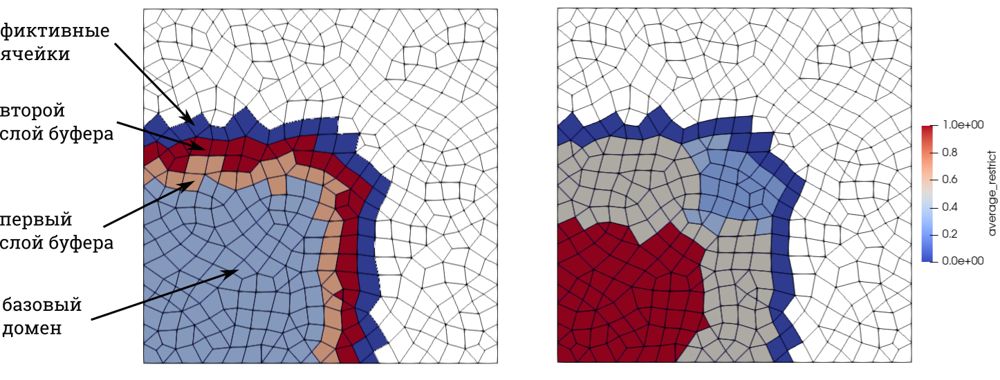

# Задача 06

## Метод Шварца. Декомпозиция расчётной области

Рассматривается уравнение Пуассона с граничными условиями Дирихле:

$$
\begin{cases}
-\nabla^2 u = f, & x \in \Omega,\\
u = g, & x \in \partial\Omega.
\end{cases}
$$

Метод Шварца — итерационный метод решения задачи на перекрывающихся поддоменах. На каждой итерации:

1. Обновляются граничные условия локальных задач.
2. Решаются локальные СЛАУ.
3. Локальные решения объединяются в глобальное.
4. Проверяется глобальная невязка.

Последовательный метод (мультипликативный): глобальное решение обновляется после каждого поддомена.

Параллельный метод (аддитивный): все поддомены используют решение предыдущей итерации, глобальное решение обновляется после завершения локальных расчётов.

## Построение локальной сетки

Исходная сетка разбивается на поддомены. Локальная сетка включает:

- Базовые ячейки — принадлежат поддомену согласно исходному разбиению.
- Буферные ячейки — реальные ячейки соседних поддоменов, образующие перекрытие.
- Ghost cells — фиктивные ячейки для задания граничных условий.



`buffer_depth` задаёт количество слоёв буферных ячеек.

Класс `GridPartition` отвечает за разбиение и построение локальных сеток.

| Метод | Назначение |
|---|---|
| `build()` | Разбиение по функции принадлежности ячейки домену |
| `build_uniform()` | Равномерное разбиение по координатам |
| `subgrid(idom)` | Получение локальной сетки |
| `n_domains()` | Количество поддоменов |
| `cell_blending_weights()` | Вычисление весов ячеек |
| `extended_blending_weights()` | Вычисление весов граничных граней |

## Объединение локальных решений

Перекрывающиеся ячейки могут присутствовать в нескольких локальных сетках. Для объединения решений используются весовые коэффициенты $\Chi_i$:

$$
u = \sum_i E_i(\Chi_i u_i), \qquad \sum_i \Chi_i = 1,
$$

где $u_i$ — локальное решение, $\Chi_i$ — вес, $E_i$ — перенос решения в глобальную область.

Реализованы три варианта весов:

- `UNITY` — единица для реальных ячеек;
- `ORIGINAL` — единица для базовых и ноль для буферных ячеек;
- `AVERAGE` — обратная величина количества поддоменов, содержащих ячейку.

Ghost cells не участвуют в сборке глобального решения.

## Граничные условия на локальных сетках

Перед решением локальной СЛАУ значения в ghost cells обновляются из текущего глобального решения. При построении локальной матрицы учитываются физические и локальные граничные условия.

## Решатель Зейделя

Для решения локальных СЛАУ используется итерационный метод Зейделя:

$$
x_i \leftarrow x_i +
\frac{b_i-\sum_j A_{ij}x_j}{A_{ii}}.
$$

Компоненты решения обновляются последовательно с использованием уже пересчитанных значений.

## MPI: основные операции

Каждому MPI-процессу соответствует один поддомен.

**Инициализация и информация о процессах:**

```cpp
MPI_Init(&argc, &argv);
MPI_Comm_rank(MPI_COMM_WORLD, &rank);
MPI_Comm_size(MPI_COMM_WORLD, &size);
```

- `MPI_Init` — инициализация MPI.
- `MPI_Comm_rank` — номер процесса.
- `MPI_Comm_size` — общее количество процессов.

**Объединение данных:**

```cpp
MPI_Allreduce(
    &local_value, &global_value,
    1, MPI_DOUBLE, MPI_MAX,
    MPI_COMM_WORLD
);
```

`MPI_Allreduce` выполняет коллективную редукцию и передаёт результат всем процессам. Основные операции: `MPI_SUM`, `MPI_MAX`, `MPI_MIN`.

В методе Шварца с помощью `MPI_MAX` определяется максимальная локальная невязка. Она используется для проверки сходимости.

**Синхронизация и завершение:**

```cpp
MPI_Barrier(MPI_COMM_WORLD);
MPI_Finalize();
```

- `MPI_Barrier` — синхронизация процессов.
- `MPI_Finalize` — завершение работы MPI.

## Задание 1. Аддитивный метод Шварца

В тесте `ddm/test.cpp/[schwarz-multiplicative]` реализован мультипликативный (полунеявный) метод Шварца.

Реализация последовательная, без использования MPI. Перед решением методом Шварца задача решается на исходной сетке обычным методом.

Необходимо на основе данной реализации создать тест `ddm/test/[schwarz-additive]`, в котором реализовать аддитивный (явный) метод Шварца.

Основное отличие двух методов заключается в порядке построения глобального решения:

- Мультипликативный метод: после решения каждого домена обновляется глобальное решение, которое используется при решении следующего домена.
- Аддитивный метод: сначала решаются все домены, а затем по полученным решениям одновременно строится новое глобальное решение.

Обе реализации должны оставаться последовательными.

## Задание 2. Исследование влияния буфера на сходимость

Исследовать влияние глубины буфера на количество итераций Шварца для мультипликативного и аддитивного методов.

Для различных вариантов разбиения и глубины буфера **заполнить таблицу**:

| Метод | Разбиение | Буфер | Количество итераций Шварца | Общее количество итераций Зейделя на первом домене |
|:---:|:---:|:---:|:---:|:---:|

В решении использовать простой итерационный метод решения СЛАУ - `SeidelMatrixSolver`. 
Для заполнения последнего столбца необходимо суммировать количество итераций Зейделя по всем итерациям Шварца для первого домена (idom = 0). Количество итераций возвращает метод `solve`.

Результаты можно посмотреть в ParaView.
Там же **проиллюстрировать сходимость** методов по итерациям Шварца, используя поле `error`.
И сравнить поведение мультипликативного и аддитивного методов при различных глубинах буфера.

## Задание 3. Реализация MPI_Allreduce

В тесте `mpi_reduce_test.cpp\[reduce]` реализована операция суммирования вектора с использованием редукции MPI. Результат операции сохраняется только на ранке 0.

Необходимо реализовать аналогичную операцию, результат которой будет доступен на всех ранках.

Для этого использовать коллективную операцию `MPI_Allreduce`.

В результате не должно возникать необходимости проверять ранг перед сравнением результата:

```cpp
if (mpi_rank == 0)
    CHECK(...);
```

Эта проверка должна выполняться на всех ранках.

## Задание 4. Реализация аддитивного метода Шварца с использованием MPI

В тесте `mpi_tests/mpi_schwarz_test.cpp/[schwarz]` нужно реализовать аддитивный метод Шварца с использованием MPI.

За основу взять последовательную реализацию из пункта 1.

Алгоритм аналогичен последовательному аддитивному методу, однако необходимо учитывать особенности распределения данных:

- Заменить структуру данных `vector<vector<...>>`, используемую для хранения решений доменов, на обычный `vector<...>`.
- Для построения глобального решения использовать коллективные операции MPI-редукции.
- Обеспечить корректное получение глобального решения всеми ранками.

## Задание 5. Исследование производительности MPI-реализации

Провести измерения времени выполнения MPI-реализации аддитивного метода Шварца.

Использовать сетку `test_data/trigrid_10000.vtk`.

Для различных вариантов разбиения и глубины буфера заполнить таблицу:

| Разбиение | Буфер | Количество итераций Шварца | Общее количество итераций Зейделя на первом домене | Время решения | Время решения СЛАУ | Время MPI-коммуникаций | MPI от общего времени, % |
|:---:|:---:|:---:|:---:|:---:|:---:|:---:|:---:|

При проведении измерений необходимо учитывать следующие условия:

- измерять только время непосредственно решения задачи, без учета инициализации
- исключить сохранение результатов в файлы на время измерений
- использовать Release-сборку
- отдельно учитывать время решения СЛАУ и время MPI-коммуникаций

Процент времени, затраченного на MPI-коммуникации, рассчитывается относительно общего времени решения задачи.

## Запуск решения

Для сборки с поддержкой MPI необходимо включить опцию `MPI`:

```bash
cmake -S . -B build-mpi -DMPI=ON
cmake --build build-mpi
```

**Запуск в VS Code:**

1. Откройте меню запуска в боковой панели (значок треугольника).
2. Выберите конфигурацию `MPI test`.
3. Либо нажмите `Ctrl+Shift+P`, найдите команду запуска и выберите `MPI test`.
